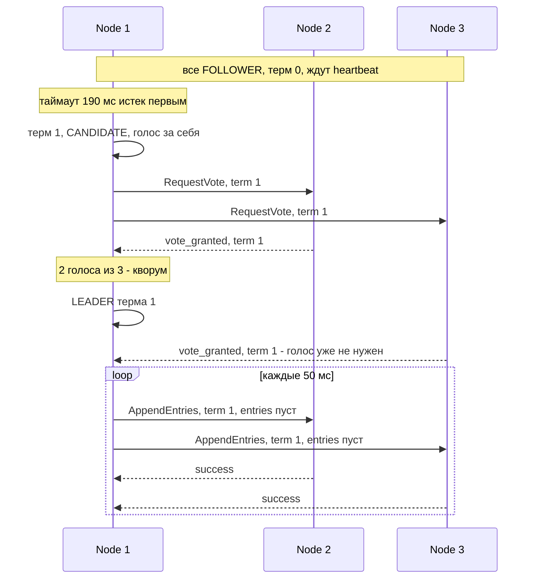
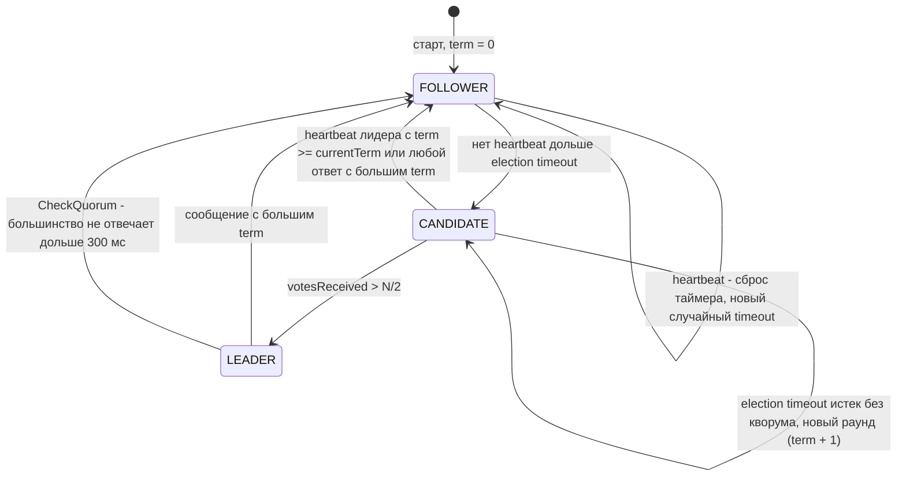
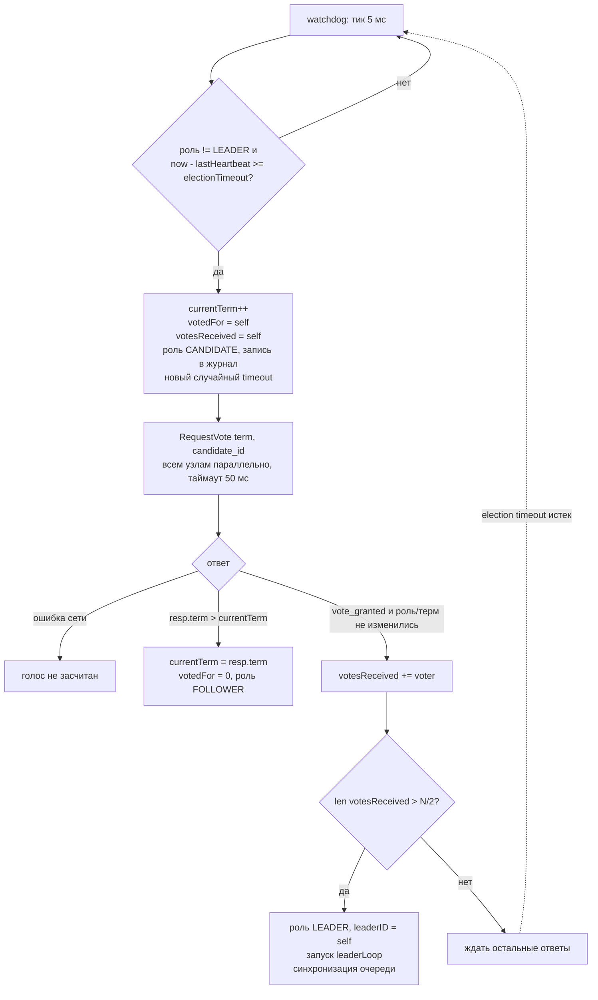
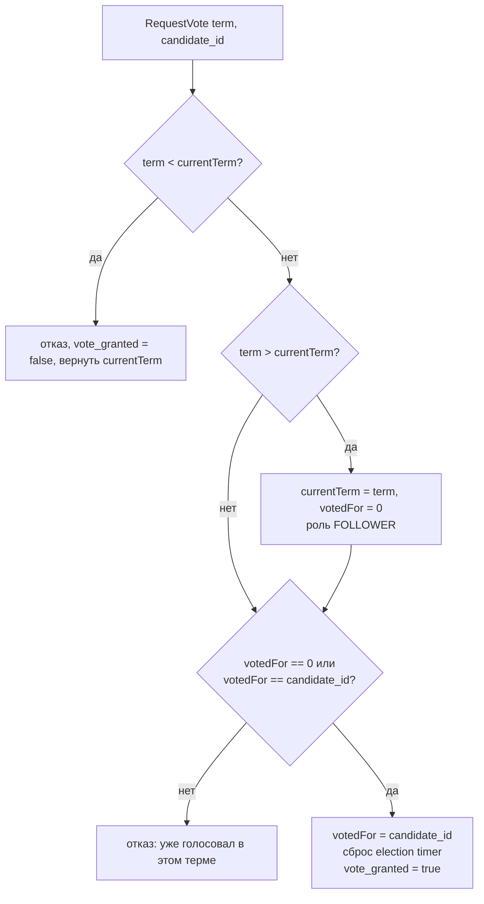
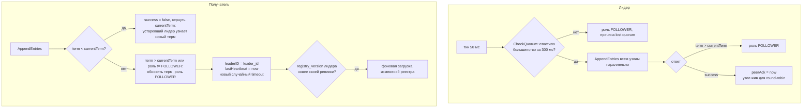
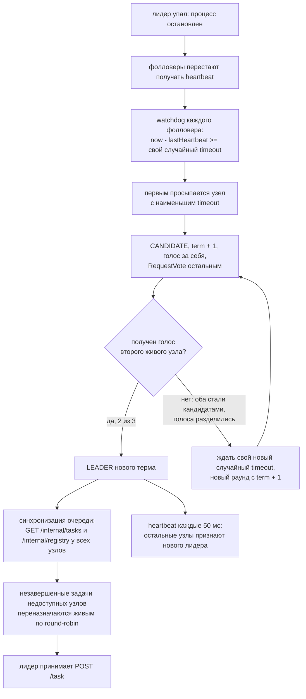

# Отчет по заданию 3. Распределенная очередь задач (Raft-based leader election)

Реализация: Go 1.25, только стандартная библиотека, RPC - HTTP/JSON. Кластер из
3 узлов (поддерживается любое число, задается флагом `-peers`). Каждый узел -
отдельный процесс `raftnode`; в интеграционных тестах узлы поднимаются в одном
процессе на реальных сокетах 127.0.0.1. Как собрать и запустить - в
[README.md](README.md). Полные результаты последнего прогона замеров -
[results/scenario.md](results/scenario.md), вывод тестов -
[results/go_test_output.txt](results/go_test_output.txt).

## Идея алгоритма

### Какую задачу решают выборы

Очередью должен управлять ровно один узел. Если раздавать задачи начнут два
узла одновременно, они выдадут одинаковые ID, round-robin собьется, одна и та
же задача может попасть на два узла. Назначить координатора вручную нельзя -
он тоже может упасть. Простое правило "координатор - живой узел с
наименьшим ID" тоже не работает: каждый узел судит о том, кто жив, по своим
сетевым сообщениям, и при задержках или разделении сети разные узлы придут к
разным выводам и выберут разных координаторов.

Нужен способ, при котором узлы **договариваются** о лидере, и договоренность
остается верной при падениях узлов, задержках сообщений и разделении сети.
Raft решает это четырьмя идеями: термы, голосование большинством, heartbeat с
таймаутом и случайные таймауты.

### Идея 1. Терм - номер эпохи

Время делится на термы - пронумерованные эпохи. Каждый терм начинается с
выборов, и в одном терме может быть не больше одного лидера. Терм работает
как логические часы: по нему любой узел сразу видит, чьи сведения новее.

- Получил сообщение с **большим** термом - значит, кластер ушел вперед без
  тебя (были выборы, о которых ты не знаешь). Узел принимает новый терм и
  становится фолловером, даже если считал себя лидером.
- Получил сообщение с **меньшим** термом - отправитель отстал. Запрос
  отвергается, а в ответе отправитель получает текущий терм и узнает, что
  устарел.

Это решает проблему "старого лидера". Лидер мог не упасть, а зависнуть
(пауза процесса, перегрузка, обрыв связи). За это время остальные выбрали
нового лидера в терме 2. Когда старый лидер очнется и пошлет heartbeat с
термом 1, фолловеры ответят `success = false, term = 2`, и он сразу
отступит. По той же причине узел отвергает `POST /internal/task` со старым
термом: устаревший лидер не может раздать задачу, даже если еще не узнал,
что его заменили.

### Идея 2. Большинство голосов

Кандидат становится лидером, только если за него проголосовало **больше
половины** всех узлов кластера (включая его самого), а каждый узел отдает
**не больше одного голоса за терм** (`votedFor`).

Почему из этого следует, что в одном терме не бывает двух лидеров: каждому из
двух лидеров нужно больше N/2 голосов, а два множества, каждое больше
половины, обязательно пересекаются хотя бы в одном узле. Этот узел должен был
бы проголосовать в одном терме дважды, а это запрещено. Для 3 узлов: два
большинства, например {1, 2} и {2, 3}, пересекаются в узле 2.

Следствия:

- **Нет "раздвоения мозга"** при разделении сети: лидера может выбрать только
  та часть, где большинство узлов. Меньшинство не наберет голосов, сколько бы
  раз ни пыталось.
- **Цена - доступность**: если упала половина узлов и больше (2 из 3),
  нового лидера не будет, и задачи не принимаются, пока узлы не вернутся.
  Система выбирает согласованность, а не доступность. Кластер из N узлов
  переживает до (N - 1) / 2 отказов: 1 из 3, 2 из 5.
- **CheckQuorum** применяет ту же логику к уже избранному лидеру: если
  большинство перестало отвечать на heartbeat, лидер сам отступает, иначе в
  меньшинстве при разделении сети остался бы лидер, продолжающий принимать
  задачи.

### Идея 3. Heartbeat и таймаут вместо точного знания об отказе

В распределенной системе нельзя отличить упавший узел от медленного: в обоих
случаях ответа просто нет. Raft не пытается это различить. Лидер регулярно
(каждые 50 мс) подтверждает, что жив, пустым AppendEntries. Если фолловер не
слышал лидера дольше election timeout (150-300 мс, то есть 3-6 пропущенных
heartbeat подряд), он **считает** лидера мертвым и начинает выборы.

Ошибка здесь безопасна. Если лидер на самом деле был жив, но медленен, новые
выборы создадут лидера с большим термом, а старый отступит при первом же
контакте (идея 1). Ошибка стоит только лишних выборов, двух лидеров в одном
терме она не создает. Поэтому таймаут выбирают в несколько раз больше
интервала heartbeat: случайная задержка одного-двух heartbeat не должна
вызывать перевыборов, а настоящее падение должно обнаруживаться быстро.

### Идея 4. Случайный таймаут - чтобы выборы заканчивались

Голосование большинством гарантирует безопасность, но не гарантирует, что
лидер вообще появится. Если бы у всех узлов был одинаковый таймаут, после
падения лидера все фолловеры стали бы кандидатами одновременно, каждый
проголосовал бы за себя, никто не набрал бы большинства - и так в каждом
раунде.

Случайный таймаут разводит узлы во времени. Первый проснувшийся узел
рассылает RequestVote; если запрос дойдет до второго узла раньше, чем у того
истечет собственный таймаут, второй узел отдаст голос и сбросит свой таймер -
выборы закончатся за один раунд. Голоса делятся, только если таймауты двух
узлов отличаются меньше, чем на время доставки RequestVote. Для равномерного
таймаута в окне 150 мс и задержки RPC около 5 мс вероятность этого для двух
узлов примерно 2 * 5 / 150, то есть около 7%. В замерах так и вышло: 1
разделение голосов на 10 падений лидера (раздел 4.2). После неудачного раунда
каждый кандидат выбирает новый случайный таймаут, поэтому вероятность k
неудач подряд падает примерно как 0.07 в степени k.

### Безопасность и живучесть

Эти идеи дают два свойства разной природы:

- **Безопасность** (не больше одного лидера в терме) гарантирована всегда,
  при любых задержках, потерях сообщений и падениях. Она следует только из
  правил "один голос на терм" и "нужно большинство" и не зависит от времени.
- **Живучесть** (лидер рано или поздно появится) зависит от времени: нужно,
  чтобы большинство узлов было живо и сообщения доставлялись быстрее
  таймаутов. Ее обеспечивают таймауты и их случайность, и она вероятностная:
  разделение голосов может повторяться, но все реже.

Здесь и проявляется "проблема времени" из методички. Слишком короткий
таймаут - ложные перевыборы при обычных задержках; слишком длинный - система
долго не замечает падения лидера. При этом ни при каком таймауте корректность
не нарушается, страдает только скорость.

### Пример: жизнь кластера по шагам

Состояние узлов записано как роль/терм/votedFor (F - FOLLOWER, C - CANDIDATE,
L - LEADER, "-" - не голосовал).

| Шаг | Событие | Node 1 | Node 2 | Node 3 |
| --- | --- | --- | --- | --- |
| 1 | Старт, у всех случайные таймауты: 190, 270, 240 мс | F/0/- | F/0/- | F/0/- |
| 2 | Через 190 мс у Node 1 истек таймаут: терм 1, голос за себя, RequestVote | C/1/1 | F/0/- | F/0/- |
| 3 | Node 2 и Node 3 видят больший терм, принимают его и голосуют за Node 1 | C/1/1 | F/1/1 | F/1/1 |
| 4 | Node 1 получил 2 голоса из 3 (свой и первый пришедший) - лидер | L/1/1 | F/1/1 | F/1/1 |
| 5 | Heartbeat каждые 50 мс, фолловеры сбрасывают таймеры, выборов нет | L/1/1 | F/1/1 | F/1/1 |
| 6 | Node 1 упал, heartbeat больше нет | упал | F/1/1 | F/1/1 |
| 7 | Таймаут Node 3 (новый случайный, 180 мс) истек раньше: терм 2 | упал | F/1/1 | C/2/3 |
| 8 | Node 2 еще не голосовал в терме 2 - голосует за Node 3 | упал | F/2/3 | C/2/3 |
| 9 | Node 3 - лидер терма 2 (2 из 3), собирает задачи со всех узлов | упал | F/2/3 | L/2/3 |
| 10 | Node 1 перезапущен с пустой памятью, терм 0 | F/0/- | F/2/3 | L/2/3 |
| 11 | Первый же heartbeat с термом 2: Node 1 принимает терм, признает лидера | F/2/- | F/2/3 | L/2/3 |

Если бы на шаге 6 Node 1 не упал, а завис и потом очнулся, считая себя
лидером терма 1, его heartbeat с термом 1 отвергли бы, а из ответов он узнал
бы терм 2 и стал фолловером - так конфликт двух "лидеров" разрешается
автоматически.

Шаги 1-5 в виде обмена сообщениями:



### Как на выборах строится очередь задач

Raft дает очереди одну гарантию: в каждом терме не больше одного лидера.
Значит, есть ровно один узел, который выдает ID и ведет круг round-robin, и
ID не пересекаются. Остальное очередь строит поверх:

- **Терм как защита от устаревшего лидера.** Задача от лидера со старым
  термом отвергается (`POST /internal/task` -> 409), поэтому зависший и
  вернувшийся лидер не раздаст задачи параллельно с новым.
- **Эпоха реестра = терм лидера.** По ней фолловер понимает, что реестр
  ведет уже другой лидер, и загружает его целиком, а не по изменениям.
- **Сохранность задач без лога.** В полном Raft новый лидер гарантированно
  содержит все зафиксированные записи: за кандидата голосуют, только если
  его лог не менее свежий, а запись считается зафиксированной, когда она
  есть у большинства. Методичка разрешает отказаться от лога, поэтому эту
  роль выполняют реплика реестра на каждом узле (расходится через версию в
  heartbeat) и синхронизация при избрании (новый лидер опрашивает все узлы и
  берет самую свежую реплику). Гарантия слабее, чем в полном Raft: задача,
  которую лидер принял и не успел распространить ни на один узел до своего
  падения, известна только узлу-исполнителю. Если в момент синхронизации
  недоступен и он, задача не восстановится.

## 1. Реализация алгоритма Raft

Код: `internal/raft`. Состояние узла (`node.go`) защищено одним мьютексом:

| Поле | Требование | Назначение |
| --- | --- | --- |
| `role` | 1.1 | FOLLOWER / CANDIDATE / LEADER, начальное - FOLLOWER |
| `currentTerm` | 1.2 | текущий терм, начинается с 0, только растет |
| `votedFor` | 1.3 | за кого узел голосовал в текущем терме (0 - ни за кого) |
| `votesReceived` | 1.4 | множество ID узлов, проголосовавших за кандидата |
| `lastHeartbeat` | 1.10 | время последнего принятого heartbeat (у лидера - отправленного) |
| `electionTimeout` | 1.6 | текущий случайный таймаут из [150, 300) мс |
| `peerAck` | - | у лидера: время последнего ответа каждого узла на heartbeat (CheckQuorum) |

Все смены роли идут через `setRoleLocked(to, reason)`, которая пишет запись
`{time, from, to, term, reason}` в журнал переходов (п. 1.14, доступен по
`GET /internal/transitions`) и в лог узла.

### 1.1 Состояния узлов и таймеры



**election_timeout (случайное значение).** При каждом сбросе таймера (старт,
принятый heartbeat, отданный голос, начало раунда выборов) узел выбирает новый
таймаут равномерно из [150, 300) мс генератором PCG с seed на узел:

```go
func (n *Node) resetElectionTimerLocked() {
	lo, hi := n.cfg.ElectionTimeoutMin, n.cfg.ElectionTimeoutMax
	n.electionTimeout = lo + time.Duration(n.rng.Int64N(int64(hi-lo)))
	n.lastHeartbeat = time.Now()
}
```

Разные таймауты у разных узлов разводят их во времени: обычно один фолловер
просыпается заметно раньше остальных и успевает собрать голоса до того, как
другие станут кандидатами. Тест `TestElectionTimeoutIsRandomInRange` проверяет
диапазон и разброс значений.

**heartbeat_interval (50 мс).** Став лидером, узел запускает горутину
`leaderLoop`: тикер на 50 мс, на каждом тике - проверка CheckQuorum и рассылка
пустого AppendEntries всем узлам параллельно (по горутине на узел, таймаут
RPC 50 мс, медленный узел не задерживает остальных). Первый heartbeat уходит
сразу после победы на выборах.

**watchdog (фоновый поток, п. 1.11).** Отдельная горутина с тикером 5 мс:

```go
silence := time.Since(n.lastHeartbeat)
if n.role != Leader && silence >= n.electionTimeout {
	n.startElectionLocked(silence)
}
```

`startElectionLocked` только меняет состояние и запускает горутины
RequestVote, ответы обрабатываются асинхронно, поэтому watchdog и обработка
входящих RPC никогда не блокируются сетевыми вызовами. Разрешение тика 5 мс
дает погрешность обнаружения не более 5 мс.

**CheckQuorum (дополнение к методичке).** Лидер, который дольше
ElectionTimeoutMax (300 мс) не получал ответов на heartbeat от большинства
узлов, сам переходит в FOLLOWER с причиной `lost quorum`. Без этого лидер,
отрезанный от большинства (2 из 3 узлов упали или разделение сети),
продолжал бы принимать задачи, а в другой части сети мог появиться второй
лидер. Так делает etcd; в базовом Raft лидер без кворума не может
зафиксировать запись, у нас лога нет, поэтому то же свойство обеспечивается
явным отступлением.

### 1.2 Алгоритм выборов (RequestVote)



Обработка RequestVote на голосующем узле (`HandleRequestVote`):



Проверки лога нет (упрощение п. 1.8). Один голос на терм гарантирует, что в
одном терме не может быть двух лидеров: для победы нужно большинство, а два
большинства из N узлов всегда пересекаются.

Формат сообщений:

```json
// запрос кандидата
{"term": 2, "candidate_id": 3}
// ответ
{"term": 2, "vote_granted": true, "voter_id": 1}
```

### 1.3 Heartbeat (AppendEntries)



Формат heartbeat-сообщения (пустой AppendEntries, `entries` всегда пуст):

```json
{
  "term": 2,
  "leader_id": 3,
  "leader_addr": "http://127.0.0.1:8083",
  "entries": [],
  "registry_epoch": 2,
  "registry_version": 18,
  "sent_at": "2026-10-04T18:38:40.112Z"
}
```

Ответ: `{"term": 2, "success": true, "node_id": 1}`. Поля `registry_epoch` и
`registry_version` - не часть Raft, а версия реестра задач лидера (раздел 3.2):
по ним фолловер понимает, что ему пора догрузить изменения.

### 1.4 Журнал переходов

Пример `GET /internal/transitions` лидера после холодного старта:

```json
[
  {"time": "2026-10-04T22:38:37.474+04:00", "from": "FOLLOWER", "to": "FOLLOWER", "term": 0, "reason": "node started"},
  {"time": "2026-10-04T22:38:37.653+04:00", "from": "FOLLOWER", "to": "CANDIDATE", "term": 1, "reason": "no heartbeat for 179 ms (election timeout 176 ms)"},
  {"time": "2026-10-04T22:38:37.658+04:00", "from": "CANDIDATE", "to": "LEADER", "term": 1, "reason": "received 2 of 3 votes (quorum 2)"}
]
```

Другие причины, которые встречаются в логах: `election timeout 162 ms expired
without quorum, new round`, `heartbeat from leader 3 with term 2`,
`RequestVote from node 3 with higher term 3`, `node 2 has higher term 4 in
AppendEntries response`, `lost quorum: 1 of 3 nodes answered heartbeats within
300 ms`.

## 2. Реализация очереди задач

Код: `internal/queue` (логика), `internal/api` (HTTP). Структура задачи:

```go
type Task struct {
	ID           int64     `json:"id"`        // уникальный, монотонно растущий
	Data         string    `json:"data"`
	Priority     string    `json:"priority,omitempty"`
	Timestamp    time.Time `json:"timestamp"` // время создания на лидере
	Status       Status    `json:"status"`    // PENDING, PROCESSING, COMPLETED
	AssignedNode int       `json:"assigned_node"`
}
```

Каждый узел хранит в памяти:

- **свои задачи** - список задач, назначенных этому узлу (п. 2.4); их
  выполняет воркер узла: PENDING -> PROCESSING -> (work-time) -> COMPLETED;
- **реплику реестра** - все задачи кластера с назначенным узлом и статусом.
  На лидере реестр - источник истины, фолловеры держат его копию. Реплика
  нужна, чтобы задачи упавшего узла (в том числе упавшего лидера) не
  терялись и чтобы все узлы знали обо всех задачах (п. 4.5).

### 2.1 API для задач

**POST /task** - добавить задачу (только лидер).

Запрос:

```json
{"data": "Обработать заказ 12345", "priority": "high"}
```

Ответ `201 Created`:

```json
{"status": "success", "task_id": 1, "assigned_node": 1, "message": "Task assigned to node 1"}
```

Ответ узла, который не лидер: `307 Temporary Redirect`, заголовок
`Location: http://127.0.0.1:8083/task` и тело:

```json
{"status": "error", "message": "This node is not the leader", "leader": "node3", "leader_address": "http://127.0.0.1:8083"}
```

Клиенты, которые следуют редиректу (curl -L, `cmd/client`), сами попадают к
лидеру. Если лидер еще не известен (идут выборы или нет кворума) - `503` с
`"message": "This node is not the leader; leader is unknown, election in
progress"`. Лидер, который еще не закончил синхронизацию после избрания, тоже
отвечает `503` (`leader is synchronizing tasks, retry later`). Пустое `data` -
`400 {"status": "error", "message": "field 'data' is required"}`.

**GET /tasks/{node_id}** - задачи узла, доступно на любом узле. Свои задачи
узел отдает из памяти (`"source": "local"`), задачи других узлов - из реплики
реестра (`"source": "registry"`).

```json
{
  "node_id": 2,
  "tasks": [
    {"id": 2, "data": "Задача 2", "timestamp": "2026-10-04T18:38:40.112Z", "status": "PROCESSING", "assigned_node": 2},
    {"id": 5, "data": "Задача 5", "timestamp": "2026-10-04T18:38:40.372Z", "status": "PENDING", "assigned_node": 2}
  ],
  "count": 2,
  "source": "registry"
}
```

**GET /status** - роль, терм и состояние очереди узла:

```json
{
  "node_id": 3, "role": "LEADER", "term": 1, "voted_for": 3, "votes_received": [1, 3],
  "leader_id": 3, "leader_address": "http://127.0.0.1:8083", "cluster_size": 3,
  "last_heartbeat_ago_ms": 12.4, "election_timeout_ms": 157.752,
  "queue_ready": true, "own_tasks": 2, "known_tasks": 6,
  "registry_epoch": 1, "registry_version": 9, "alive_nodes": [1, 2, 3],
  "address": "http://127.0.0.1:8083", "heap_mb": 2.0
}
```

### 2.2 Стратегия распределения задач (round-robin)

Лидер держит указатель `rrNext` по списку всех узлов, упорядоченному по ID
(включая себя), и для каждой новой задачи берет следующий **живой** узел.
Живость лидер знает по ответам на heartbeat (раздел 3.2). Пример из теста
`TestScenario2TaskDistribution` (лидер - любой из узлов, порядок от него не
зависит):

| Задача | Назначенный узел |
| --- | --- |
| Task 1 | Node 1 |
| Task 2 | Node 2 |
| Task 3 | Node 3 |
| Task 4 | Node 1 |
| Task 5 | Node 2 |
| Task 6 | Node 3 |
| ... | ... |
| Task 10 | Node 1 |

Итог для 10 задач: N1:4, N2:3, N3:3. Когда узел падает, он пропускается:
после падения Node 2 задачи идут 1, 3, 1, 3, ... Новый лидер продолжает круг
с узла, следующего за получателем задачи с максимальным ID.

Порядок обработки POST /task на лидере (раздача последовательная, под
отдельным мьютексом, чтобы ID и круг round-robin не перемешивались):

1. Проверить, что узел - лидер и синхронизация в этом терме завершена.
2. `task_id = nextID++`, `timestamp = now`, `status = PENDING`.
3. Выбрать следующий живой узел, отправить ему `POST /internal/task`
   (лидеру себе - локальный вызов).
4. Если узел не подтвердил (ошибка, таймаут 300 мс, отказ) - взять
   следующий живой узел.
5. После подтверждения - записать задачу в реестр (версия реестра +1) и
   ответить клиенту.

### 2.3 Внутренние API (между узлами)

**POST /internal/task** - узел принимает задачу от лидера (п. 2.9-2.10).

```json
// запрос от лидера
{"term": 1, "leader_id": 3, "task_id": 42, "data": "Обработать заказ 12345", "priority": "high",
 "timestamp": "2024-01-15T10:30:00Z", "status": "PENDING", "assigned_node": 2}
// ответ узла
{"status": "accepted", "node_id": 2}
```

Если `term` меньше текущего терма узла, задача пришла от устаревшего лидера и
отвергается: `409 {"status": "rejected: request from a leader with stale term",
"node_id": 2}`. Повторная доставка той же задачи безопасна (идемпотентно).

**GET /internal/tasks** - задачи, которые узел держит в памяти; новый лидер
опрашивает этот эндпоинт у всех узлов (п. 3.9):

```json
{"node_id": 2, "tasks": [{"id": 42, "data": "...", "status": "PENDING", "assigned_node": 2, "timestamp": "..."},
                         {"id": 45, "data": "...", "status": "PROCESSING", "assigned_node": 2, "timestamp": "..."}], "count": 2}
```

**GET /internal/registry?since=N[&epoch=E&version=V]** - реплика реестра узла:
изменения после версии N (`since=0` - весь реестр, `"full": true`). Если
переданы `epoch` и `version` и реплика узла той же эпохи не новее, задачи не
передаются (`"unchanged": true`) - так новый лидер не перекачивает реестр,
который у него уже есть:

```json
{"epoch": 1, "version": 9, "full": false, "tasks": [
  {"id": 6, "data": "Отправить уведомление", "priority": "low", "timestamp": "...", "status": "PENDING", "assigned_node": 3}]}
```

**POST /internal/task-status** - узел сообщает лидеру о смене статусов своих
задач (пачкой):

```json
// запрос
{"node_id": 2, "updates": [{"task_id": 2, "status": "PROCESSING"}]}
// ответ лидера
{"applied": 1, "unknown": []}
```

Лидер применяет статус, только если задача числится за этим узлом и статус
двигается вперед (PENDING < PROCESSING < COMPLETED). Задачи, которых лидер
пока не знает (`unknown`), узел повторит позже. Не-лидер отвечает 307.

**GET /internal/transitions** - журнал переходов (раздел 1.4).

## 3. Отказоустойчивость и синхронизация

### 3.1 Механизм перевыборов



1. **Обнаружение падения.** Фолловер перестает получать heartbeat; через
   свой election timeout (150-300 мс с момента последнего heartbeat) watchdog
   переводит его в CANDIDATE. Так как последний heartbeat пришел за 0-50 мс
   до падения, обнаружение занимает от 100 до 300 мс после падения.
2. **Выборы.** Кандидат увеличивает терм, голосует за себя и рассылает
   RequestVote. Второй живой узел еще не голосовал в новом терме и отдает
   голос; 2 из 3 - кворум, кандидат становится лидером. RequestVote на
   localhost занимает 2-9 мс, поэтому выборы почти всегда завершаются через
   несколько миллисекунд после обнаружения. Если оба живых узла стали
   кандидатами почти одновременно (их таймауты отличаются меньше чем на время
   RPC), голоса делятся 1:1, и через новый случайный таймаут проходит второй
   раунд.
3. **Время восстановления** (от остановки процесса лидера, 10 запусков, см.
   раздел 4.2): обнаружение - в среднем 223 мс (169-270 мс), выборы - в
   среднем 245 мс (173-428 мс), лидер готов принимать задачи - в среднем
   256 мс (189-439 мс). Требование < 1 с (и <= 500 мс для выборов)
   выполняется с запасом.

### 3.2 Синхронизация состояния очереди

**Распространение реестра при нормальной работе.** У реестра есть эпоха
(терм лидера, который его ведет) и версия (растет при каждом изменении,
у каждой задачи хранится версия ее последнего изменения). Heartbeat несет
`registry_epoch` и `registry_version` лидера. Фолловер, у которого версия
меньше, в фоне запрашивает `GET /internal/registry?since=<своя версия>` и
получает только изменения; при другой эпохе (сменился лидер) - весь реестр.
Так все узлы приходят к одинаковому реестру без отдельной рассылки, обычно
за 1-2 heartbeat.

**Синхронизация при переходе в LEADER (п. 3.3-3.5, 3.9-3.10).** Пока она не
завершена, новый лидер отвечает на POST /task кодом 503.

1. Параллельно у всех узлов запрашиваются `GET /internal/tasks` (задачи,
   которые узел реально держит) и `GET /internal/registry` (реплика реестра,
   передается, только если она новее лидерской), таймаут 1 с.
2. Слияние (`mergeSnapshots`): база - самая свежая реплика реестра (по эпохе
   и версии), к ней добавляются задачи из остальных реплик, затем поверх -
   задачи, которые узлы держат в памяти: владелец и статус берутся у
   держателя.
3. Реестр пересоздается с эпохой = новому терму; `nextID = max(id) + 1`, так
   ID остаются уникальными и монотонными после смены лидера.
4. Незавершенные задачи, чей узел не ответил или не держит их (узел
   перезапускался), переназначаются живым узлам по round-robin.
5. Фолловеры видят новую эпоху в heartbeat и загружают реестр целиком.

Задачи упавшего лидера при этом не теряются: они есть в репликах реестра на
фолловерах, незавершенные - переназначаются, завершенные остаются в реестре
за упавшим узлом.

**Переназначение задач упавшего узла.** Лидер считает узел упавшим, если тот
не ответил ни на один heartbeat дольше 300 мс (`-dead-after`, 6 пропущенных
heartbeat). Его незавершенные задачи (PENDING и PROCESSING) лидер отправляет
живым узлам через `POST /internal/task` со статусом PENDING и исключает узел
из round-robin. Как только узел снова отвечает на heartbeat, он возвращается в
круг.

**Возвращение узла после перезапуска.** Память узла пуста; первый heartbeat
приносит лидерскую версию реестра, узел загружает реестр целиком и забирает в
свою память задачи, которые в реестре числятся за ним (`reconcileOwnLocked`).
Задачи, которые за время его отсутствия переназначены другим, он не берет.

**Ограничение.** Если узел не упал, а временно потерял связь дольше 300 мс,
его задачи переназначаются, и задача, которую он успел начать, может
выполниться дважды (семантика at-least-once). После восстановления связи узел
получает реестр и отдает переназначенные задачи.

## 4. Тестирование

### 4.1 Сценарии тестирования

Интеграционные тесты - `internal/cluster/scenarios_test.go` (кластер из 3
узлов в одном процессе, реальные HTTP-запросы), unit-тесты -
`internal/raft/raft_test.go`, `internal/queue/queue_test.go`. Те же сценарии
на отдельных процессах с замерами времени прогоняет `cmd/scenario`.

| N | Сценарий | Действия | Ожидаемый результат | Тест |
| --- | --- | --- | --- | --- |
| 1 | Выбор лидера | Запустить 3 узла | Через < 1 с ровно один лидер, остальные - его фолловеры в том же терме; в журнале переход CANDIDATE -> LEADER с причиной | `TestScenario1LeaderElection` |
| 2 | Распределение задач | Добавить 10 задач | ID 1..10, узлы 1,2,3,1,...; у узлов в памяти 4/3/3 задачи | `TestScenario2TaskDistribution` |
| - | Только лидер принимает задачи (4.3) | POST /task каждому фолловеру и лидеру | Фолловер: 307 с адресом лидера, задача не создана; лидер: 201 | `TestOnlyLeaderAcceptsTasks` |
| 3 | Падение лидера | Остановить лидера | Через < 1 с новый лидер с большим термом; обнаружение <= 300 мс, выборы <= 500 мс | `TestScenario3LeaderFailure` |
| 4 | Работа после падения | Добавить 10 задач, убить лидера, добавить 5 | ID 11..15, задачи идут по кругу только живым узлам | `TestScenario4And5TasksSurviveLeaderChange` |
| 5 | Сохранность задач | Сравнить реестры и задачи всех узлов | 15/15 задач, реестры всех узлов совпадают, каждая незавершенная задача в памяти живого владельца | `TestScenario4And5TasksSurviveLeaderChange` (`checkNoLoss`) |
| 6 | Отказ фолловера | Добавить 6 задач, убить фолловера, добавить 4 | Задачи упавшего переназначены за ~300 мс, лидер и терм не меняются, новые задачи не попадают на упавший узел | `TestScenario6FollowerFailure` |
| 7 | Восстановление фолловера | Выполнить 6 задач, убить фолловера, добавить 2, перезапустить его, добавить 3 | Узел - FOLLOWER того же лидера и терма, получил реестр, восстановил свои задачи, снова получает задачи | `TestScenario7FollowerRecovery` |
| - | Потеря и восстановление кворума | Убить 2 из 3 узлов, затем вернуть один | Лидер отступает (`lost quorum`), POST /task - 503; после возвращения узла выбран лидер, задачи на месте | `TestQuorumLossAndRecovery` |

Unit-тесты: голос один раз за терм и сброс голоса при большем терме
(`TestVoteOncePerTerm`), отказ heartbeat со старым термом и отступление лидера
при большем (`TestAppendEntriesTermRules`), отступление кандидата
(`TestCandidateStepsDownOnHigherTermVoteResponse`), выборы и перевыборы в
памяти (`TestElectionAndReelection`), отсутствие лидера у одиночного узла
(`TestNoLeaderWithoutQuorum`), CheckQuorum (`TestLeaderStepsDownWithoutQuorum`),
диапазон таймаута, round-robin с пропуском мертвых узлов, отказ задачи от
старого терма, правила применения статусов, сверка своих задач с реестром,
слияние состояний при синхронизации, пропуск неизмененных реплик реестра.

**Воспроизводимость (п. 4.6).** Тесты проверяют инварианты (ровно один
лидер, время, полнота и согласованность задач), а не то, какой узел победит;
генератор таймаутов имеет фиксированный seed. Прогон `go test -count=20 ./...`
на итоговом коде (24 теста, из них 8 интеграционных - 160 запусков кластера)
прошел без единого сбоя.

**Логирование (п. 4.8).** Каждый шаг сценария пишется через `t.Logf` с
отметкой времени от начала теста (видно с `-v`), логи узлов выводятся при
падении теста или с `LAB3_NODE_LOGS=1`. Пример (`go test -v`, сценарий 3):

```
[  0.201s] leader 1 term 1
[  0.201s] leader 1 killed
[  0.358s] new leader 2 term 2 ready after 156ms
[  0.358s] node 2: FOLLOWER -> CANDIDATE term 2 at +151ms: no heartbeat for 158 ms (election timeout 157 ms)
[  0.358s] node 2: CANDIDATE -> LEADER term 2 at +151ms: received 2 of 3 votes (quorum 2)
[  0.358s] failure detected after 151ms, new leader elected after 151ms
```

Потеря кворума:

```
[  0.233s] followers [2 3] killed, leader 1 left alone
[  0.549s] node 1 stepped down after 317ms: lost quorum: 1 of 3 nodes answered heartbeats within 300 ms
[  0.550s] POST /task without quorum -> 503 "This node is not the leader; leader is unknown, election in progress"
[  0.550s] node 2 restarted
[  0.710s] leader 1 elected 160ms after quorum restored
[  0.712s] all 6 tasks known to nodes [1 2], registry epoch 2 version 6, per node map[1:6]
```

### 4.2 Результаты тестирования

Ниже - прогон `cmd/scenario` на отдельных процессах (Windows 11, 8 CPU,
узлы на 127.0.0.1, work-time 2 с). Все 7 сценариев - OK.

**Сценарии 1-7 на одном кластере** (между сценариями 5 и 6 бывший лидер
перезапускается и возвращается фолловером, чтобы в сценарии 6 снова было 3
узла):

| N | Сценарий | Действия | Ожидаемый результат | Фактический результат | Итог |
| --- | --- | --- | --- | --- | --- |
| 1 | Выбор лидера | Запустить 3 узла | Один узел становится лидером за < 1 с | Node 1 - лидер (терм 1) через 196 мс после старта узлов (запуск процессов ОС: 86 мс) | OK |
| 2 | Распределение задач | Добавить 10 задач | Round-robin 1,2,3,1,...: N1:4, N2:3, N3:3 | Задачи 1-10 -> узлы [1 2 3 1 2 3 1 2 3 1]; N1:4, N2:3, N3:3 | OK |
| 3 | Падение лидера | Остановить процесс лидера | Через < 1 с появляется новый лидер | Node 3 - лидер (терм 2): обнаружение 256 мс, выборы 262 мс, готов 278 мс; переназначено 4 задачи | OK |
| 4 | Работа после падения | Добавить 5 задач новому лидеру | Задачи принимаются и распределяются по живым узлам | Задачи 11-15 -> узлы [2 3 2 3 2] | OK |
| 5 | Сохранность задач | Сравнить задачи на всех узлах | Задачи не потеряны, все учтены, состояние согласовано | 15/15 задач на узлах [2 3], реестры совпадают; N2:8, N3:7 | OK |
| 6 | Отказ фолловера | Вернуть бывшего лидера, остановить фолловера, добавить 3 задачи | Лидер не меняется, задачи фолловера переназначаются, новые идут только живым | Лидер Node 3 без изменений; 8 задач переназначены через 310 мс; новые задачи -> [3 1 3] | OK |
| 7 | Восстановление фолловера | Перезапустить фолловера, добавить 3 задачи | Узел возвращается фолловером, получает реестр и снова участвует в round-robin | Node 2 - FOLLOWER (терм 2), реестр получен за 136 мс; новые задачи -> [1 2 3]; всего 21 задача, потерь нет | OK |

**Сценарий "Падение лидера"** (время от запуска кластера):

| Время | Событие |
| --- | --- |
| 0.000 с | Запуск кластера (3 узла) |
| 0.086 с | Все 3 процесса узлов запущены |
| 0.248 с | Node 1: FOLLOWER -> CANDIDATE (терм 1): no heartbeat for 198 ms (election timeout 191 ms) |
| 0.283 с | Node 1: CANDIDATE -> LEADER (терм 1): received 2 of 3 votes (quorum 2) |
| 0.303 с | Node 1 признан лидером всеми узлами, синхронизация завершена |
| 0.337 с | Добавлено 10 задач: N1:4, N2:3, N3:3 |
| 1.339 с | Node 1 (лидер) остановлен - эмуляция падения процесса |
| 1.595 с | Node 3 не получал heartbeat 260 мс (election timeout 258 мс): FOLLOWER -> CANDIDATE (терм 2) |
| 1.600 с | Node 3: CANDIDATE -> LEADER (терм 2), получено 2 из 3 голосов |
| 1.617 с | Node 3 собрал задачи со всех узлов, переназначил 4 незавершенные задачи Node 1, принимает задачи |
| Результат | Система восстановлена за 278 мс (выборы - 262 мс после падения) |

**Сценарий "Сохранность задач"** (тот же прогон):

| Шаг | Действие | Результат |
| --- | --- | --- |
| 1 | Добавить 10 задач (лидер Node 1) | Задачи распределены: N1:4, N2:3, N3:3 |
| 2 | Подождать 1 с | PENDING 7, PROCESSING 3, COMPLETED 0 |
| 3 | Остановить Node 1 | Лидер падает |
| 4 | Ждать нового лидера | Node 3 - лидер терма 2 через 262 мс |
| 5 | Синхронизация на Node 3 | Реестр из 10 задач восстановлен, 4 незавершенные задачи Node 1 отданы Node 2 и Node 3 |
| 6 | Добавить 5 задач | ID 11-15 (нумерация продолжилась), узлы 2, 3, 2, 3, 2 |
| 7 | Сравнить задачи на всех узлах | 15/15 задач, реестры Node 2 и Node 3 совпадают (эпоха 2, версия 19), каждая незавершенная задача - в памяти живого владельца |
| Результат | Задачи не потеряны при смене лидера | |

**Сценарии "Отказ фолловера" и "Восстановление фолловера":**

| Время | Событие |
| --- | --- |
| 1.679 с | Node 1 (бывший лидер) перезапущен с пустой памятью |
| 1.935 с | Node 1 - FOLLOWER лидера 3 (терм 2), получил реестр, лидер включил его в round-robin |
| 1.935 с | Node 2 (фолловер, 8 незавершенных задач) остановлен |
| 2.237 с | Лидер признал Node 2 упавшим (нет ответа на heartbeat дольше 300 мс) |
| 2.245 с | 8 задач Node 2 переназначены на Node 1 и Node 3 |
| 2.249 с | Добавлено 3 задачи -> узлы 3, 1, 3 (Node 2 пропускается) |
| 2.249 с | Node 2 перезапущен с пустой памятью |
| 2.384 с | Node 2 - FOLLOWER лидера 3 (терм 2), реестр получен (своих задач нет - все переназначены) |
| 2.387 с | Добавлено 3 задачи -> узлы 1, 2, 3 (Node 2 снова в круге) |
| 2.408 с | Итог: 21 задача, реестры всех узлов совпадают, потерь нет |
| Результат | Лидер и терм не менялись; задачи упавшего фолловера переназначены за 310 мс |

**Холодный старт, 10 запусков.** "Старт узлов" - когда последний процесс
начал работу (накладные расходы ОС на запуск процессов), "выборы" - от этого
момента до перехода в LEADER.

| Запуск | Лидер | Старт узлов | Выборы | LEADER от запуска | Готов принимать задачи | Кандидатов |
| --- | --- | --- | --- | --- | --- | --- |
| 1 | Node 2 | 58 мс | 216 мс | 274 мс | 290 мс | 1 |
| 2 | Node 3 | 131 мс | 169 мс | 301 мс | 309 мс | 1 |
| 3 | Node 1 | 91 мс | 139 мс | 230 мс | 238 мс | 1 |
| 4 | Node 1 | 161 мс | 168 мс | 329 мс | 334 мс | 1 |
| 5 | Node 1 | 52 мс | 237 мс | 290 мс | 300 мс | 1 |
| 6 | Node 3 | 89 мс | 172 мс | 261 мс | 268 мс | 1 |
| 7 | Node 1 | 83 мс | 182 мс | 265 мс | 271 мс | 1 |
| 8 | Node 1 | 76 мс | 176 мс | 252 мс | 268 мс | 1 |
| 9 | Node 2 | 139 мс | 236 мс | 375 мс | 384 мс | 1 |
| 10 | Node 2 | 85 мс | 154 мс | 239 мс | 245 мс | 1 |

Выборы от старта узлов: в среднем 185 мс (139-237 мс), с учетом запуска
процессов - 281 мс (230-375 мс). Во всех запусках лидер появился в первом же
раунде.

**Падение лидера, 10 запусков** (время от остановки процесса лидера):

| Запуск | Смена лидера | Обнаружение | Выборы | Готов | Кандидатов |
| --- | --- | --- | --- | --- | --- |
| 1 | Node 1 -> Node 3 | 203 мс | 206 мс | 219 мс | 1 |
| 2 | Node 1 -> Node 2 | 169 мс | 173 мс | 189 мс | 1 |
| 3 | Node 1 -> Node 2 | 221 мс | 226 мс | 239 мс | 1 |
| 4 | Node 1 -> Node 3 | 241 мс | 428 мс | 439 мс | 3 |
| 5 | Node 1 -> Node 2 | 216 мс | 220 мс | 233 мс | 1 |
| 6 | Node 1 -> Node 2 | 230 мс | 235 мс | 244 мс | 1 |
| 7 | Node 3 -> Node 1 | 211 мс | 212 мс | 215 мс | 1 |
| 8 | Node 3 -> Node 2 | 270 мс | 278 мс | 290 мс | 1 |
| 9 | Node 3 -> Node 2 | 268 мс | 270 мс | 278 мс | 1 |
| 10 | Node 1 -> Node 2 | 198 мс | 201 мс | 212 мс | 1 |

Обнаружение: в среднем 223 мс, максимум 270 мс (<= election timeout 300 мс,
п. 3.7). Выборы: в среднем 245 мс, максимум 428 мс (<= 500 мс, п. 3.8). В
запуске 4 оба фолловера стали кандидатами почти одновременно, голоса
разделились, лидер выбран во втором раунде (терм 3) - ожидаемое поведение
Raft, см. раздел 6.

**Производительность** (отдельный кластер, work-time 0, клиент на той же
машине):

| Замер | Значение |
| --- | --- |
| Задержка POST /task, 1000 последовательных запросов | p50 0.58 мс, p95 1.17 мс, p99 1.49 мс, макс 2.27 мс |
| Пропускная способность, 1 клиент | 1468 задач/с |
| Пропускная способность, 16 клиентов, 5000 задач | 4984 задач/с |
| 50000 задач в системе: распределение | N1:16667, N2:16667, N3:16666 |
| 50000 задач: сходимость реестров на всех узлах | 337 мс |
| 50000 задач: память (heap) узлов | 13.4 / 25.6 / 16.3 МБ (больше всего у лидера) |
| 50000 задач: перезапуск фолловера, получение реестра | 549 мс |
| 50000 задач: падение лидера, новый лидер готов | 589 мс (из них синхронизация 426 мс) |

## 5. Результаты работы системы

| Параметр | Значение |
| --- | --- |
| Количество узлов | 3 (код работает с любым N, кворум N/2 + 1) |
| Время выбора лидера (холодный старт) | 185 мс в среднем (139-237 мс) от старта узлов; 281 мс с учетом запуска процессов |
| Время восстановления после падения | 256 мс в среднем (189-439 мс) до готовности нового лидера; выборы - 245 мс (173-428 мс) |
| Heartbeat интервал | 50 мс |
| Election timeout | случайный, равномерно 150-300 мс, перевыбирается при каждом сбросе таймера |
| Максимальное число задач в системе | проверено 50000 (heap до 26 МБ на узел), ограничено памятью узла |
| Время добавления задачи | p50 0.58 мс, p99 1.49 мс (лидер доставляет задачу узлу и ждет подтверждения) |
| Пропускная способность (задач/сек) | около 1500 (1 клиент), около 5000 (16 параллельных клиентов) |

Дополнительно: переназначение задач упавшего узла - около 300 мс (порог
`-dead-after`), отступление лидера без кворума - 300-350 мс, возвращение
перезапущенного узла с получением реестра - 136 мс (21 задача) и 549 мс
(50000 задач).

## 6. Анализ поведения системы

**1. Как система ведет себя при нормальной работе?**

Ответ: Через 140-240 мс после старта первый проснувшийся фолловер становится
кандидатом и почти сразу (за несколько миллисекунд) получает голос второго
узла; дальше лидер каждые 50 мс шлет heartbeat, фолловеры сбрасывают таймеры,
терм не меняется, новых выборов нет. Задачи принимает только лидер; каждая
доставляется выбранному по round-robin узлу и подтверждается им до ответа
клиенту (p50 0.58 мс). Реестр задач расходится по фолловерам через версию в
heartbeat за 1-2 интервала, поэтому любой узел отвечает на `GET /tasks/{id}`
для любого узла. Воркеры выполняют свои задачи и сообщают статусы лидеру
пачками. Нагрузка на сеть в покое - N-1 маленьких HTTP-запросов каждые 50 мс.

**2. Как система реагирует на падение лидера?**

Ответ: Фолловеры перестают получать heartbeat; первый из них через свой
election timeout (169-270 мс после падения) становится кандидатом, получает
голос второго живого узла и становится лидером следующего терма. Новый лидер
собирает задачи со всех узлов, восстанавливает полный реестр, продолжает
нумерацию задач и переназначает незавершенные задачи упавшего лидера живым
узлам. Задачи снова принимаются через 189-439 мс после падения, ни одна
задача не теряется. Пока лидера нет, узлы отвечают на `POST /task` кодом 503
(или 307 на старый адрес, который не отвечает) - клиент повторяет запрос
(`cmd/client` делает это сам). Вернувшийся бывший лидер стартует с термом 0,
получает heartbeat с большим термом и становится фолловером, не сбивая
нового лидера.

**3. Как система реагирует на падение фолловера?**

Ответ: Лидер и терм не меняются, кворум 2 из 3 сохраняется, задачи
принимаются без перерыва. Через 300 мс без ответов на heartbeat лидер
считает узел упавшим, исключает его из round-robin и переназначает его
незавершенные задачи живым узлам (8 задач за 310 мс). Перезапущенный
фолловер получает heartbeat, загружает реестр, забирает задачи, которые за ним
числятся, и возвращается в круг распределения. Если падают 2 из 3 узлов,
оставшийся лидер теряет кворум и через 300-350 мс отступает (CheckQuorum):
задачи не принимаются (503), пока не вернется хотя бы один узел - система
предпочитает согласованность доступности, двух лидеров быть не может.

**4. Какие проблемы были выявлены?**

Ответ:

- *Лидер без кворума.* В первой версии лидер, оставшийся один из трех,
  продолжал принимать задачи, а при разделении сети в другой части мог
  появиться второй лидер. Добавлен CheckQuorum: лидер без ответа большинства
  дольше 300 мс отступает.
- *Разделение голосов.* Если таймауты двух фолловеров отличаются меньше,
  чем на время RequestVote, оба становятся кандидатами, голоса делятся 1:1 и
  нужен второй раунд (+150-300 мс). Наблюдалось в 1 из 10 замеров падения
  лидера (выборы 428 мс). Случайный таймаут делает это редким, но не
  исключает; уменьшить вероятность можно более широким диапазоном таймаута.
- *Синхронный вывод логов.* Узел пишет запись о переходе в лог под
  блокировкой состояния; на Windows запись в файл периодически занимала
  25-35 мс (вероятно, проверка файла антивирусом), и RequestVote уходил с
  такой задержкой - это провоцировало разделение голосов почти в каждом
  втором прогоне основного сценария. Вывод логов перенесен в фоновую горутину
  (`cmd/raftnode/asyncwriter.go`), после этого задержки исчезли.
- *Время синхронизации росло с числом задач.* При 50000 задачах новый лидер
  был готов только через 0.93-1.17 с: синхронизация (830 мс) перекачивала
  полный реестр с фолловера, хотя такой же у лидера уже был. Теперь узел не
  передает реплику, которая не новее лидерской: синхронизация 320-430 мс,
  лидер готов через 589 мс. Полная передача реестра при смене эпохи и при
  перезапуске узла остается O(N) (549 мс для 50000 задач); для больших
  объемов нужны снапшоты и инкрементальный лог, то есть полноценная
  репликация Raft.
- *Повторное выполнение.* Если узел не упал, а потерял связь дольше
  300 мс, его задачи переназначаются, и начатая им задача может выполниться
  дважды (at-least-once). Ровно-один-раз требует подтверждения выполнения
  через лидера и идемпотентных задач.
- *Нет PreVote.* Изолированный узел продолжает увеличивать терм (в тесте
  одиночный узел дошел с терма 1 до 4 за 0.8 с); вернувшись, он заставит
  лидера отступить из-за большего терма, и пройдут лишние выборы.
- *Лидер - узкое место.* Все задачи проходят через лидера, раздача
  последовательная (около 5000 задач/с); зависший, но не упавший узел
  задерживает раздачу до таймаута доставки (300 мс), пока лидер не признает
  его упавшим.
- *Состояние только в памяти* (допущение методички): при одновременном
  падении всех узлов задачи теряются.
- *Первый запуск процесса на Windows* (новый исполняемый файл) занимал до
  1.5 с и искажал замер холодного старта; `cmd/scenario` прогревает файл
  перед замерами и отделяет время запуска процессов от времени выборов.

## Соответствие требованиям

| N | Требование | Где реализовано / проверено |
| --- | --- | --- |
| 1.1 | Состояния FOLLOWER/CANDIDATE/LEADER, старт - FOLLOWER | `raft/role.go`, `Node.Start` |
| 1.2-1.4 | currentTerm, votedFor, votesReceived | поля `raft.Node`, видны в `GET /status` |
| 1.5, 1.10 | Heartbeat каждые 50 мс, пустой AppendEntries, обновление lastHeartbeat | `raft/heartbeat.go`, `HandleAppendEntries` |
| 1.6 | Election timeout 150-300 мс, случайный | `resetElectionTimerLocked`, `TestElectionTimeoutIsRandomInRange` |
| 1.7 | Кандидат: term + 1, голос за себя, RequestVote | `startElectionLocked`, `requestVote` |
| 1.8 | Один голос на терм, без проверки лога | `HandleRequestVote`, `TestVoteOncePerTerm` |
| 1.9 | Лидер при votesReceived > N/2 | `handleVoteResponse` |
| 1.11 | Watchdog в фоновом потоке | `raft/watchdog.go` |
| 1.12-1.13 | RequestVote и AppendEntries - сетевые вызовы | HTTP `POST /raft/request-vote`, `/raft/append-entries` |
| 1.14 | Журнал переходов с причиной и термом | `raft/transitions.go`, `GET /internal/transitions` |
| 2.1-2.2 | Только лидер принимает задачи, иначе 307 с адресом лидера | `api/public.go`, `TestOnlyLeaderAcceptsTasks` |
| 2.3 | Round-robin | `queue/dispatcher.go`, `TestScenario2TaskDistribution`, `TestRoundRobinSkipsDeadNodes` |
| 2.4-2.5 | Свои задачи в памяти, `GET /tasks/{node_id}` | `queue/store.go` |
| 2.6, 2.8 | Структура задачи, уникальный монотонный ID | `queue/task.go`, `nextID` |
| 2.7 | HTTP/REST API | `internal/api` |
| 2.9-2.10 | Доставка задачи узлу по сети, подтверждение | `POST /internal/task`, `deliverAndRecord` |
| 3.1-3.2 | Автоматические перевыборы, работа продолжается | `TestScenario3LeaderFailure`, `TestScenario4And5TasksSurviveLeaderChange` |
| 3.3-3.5, 3.9-3.10 | Новый лидер собирает задачи со всех узлов при переходе в LEADER | `queue/sync.go`, `TestMergeSnapshots` |
| 3.4 | Задачи не теряются | `checkNoLoss` во всех интеграционных тестах |
| 3.6 | Симуляция отключения - остановка процесса / горутин | `procCluster.kill` (cmd/scenario), `Cluster.Kill` (тесты) |
| 3.7-3.8 | Обнаружение <= 300 мс, выборы <= 500 мс | раздел 4.2: максимум 270 и 428 мс |
| 4.1-4.5, 4.7 | Тесты сценариев | раздел 4.1 |
| 4.6 | Воспроизводимость | `go test -count=20 ./...` без сбоев |
| 4.8 | Логирование тестов | `harness.step`, `LAB3_NODE_LOGS` |
